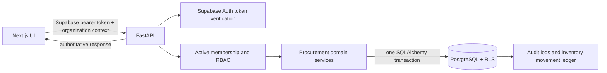

# PharmaIntelligence Architecture

## Application

The repository contains a Next.js 15 / React 19 / TypeScript frontend under `apps/web` and a FastAPI / Pydantic / async SQLAlchemy API under `apps/api`. Supabase Auth owns authentication. The web client sends the authenticated access token to FastAPI through the shared typed API client. The API validates the token, resolves organization memberships and role permissions, then uses a transaction-scoped PostgreSQL session. The browser never receives service-role keys or database credentials.

The dashboard workspace is `apps/web/src/components/dashboard-workspace.tsx`. Procurement screens live in `procurement-workspace.tsx`. Overview, analytics, sample report exports, and AI Copilot remain sample UI; the dashboard banner identifies that boundary. Orders, suppliers, pharmacy inventory batches, and stock movements load from API responses and show loading, empty, and error states.

## Backend and database

Identity endpoints and the procurement module share one FastAPI application, one Supabase Auth identity model, one SQLAlchemy session factory, and one database. The procurement module is in `apps/api/app/modules/procurement`; its router, Pydantic schemas, SQLAlchemy models, and domain services use the existing identity `Base`, `Organization`, `Principal`, and `AuditLog`.

The first SQL migration defines identity. The procurement migration adds a shared product catalog, supplier product relationships and batch stock, tenant-owned purchase orders/items, pharmacy inventory batches, and append-only movements. Pharmacy and supplier organizations reuse `organizations`; `organizations.id` remains the tenant key. No duplicate authentication, product, or internal-inventory system is introduced.

## Authorization and data flow

`X-Organization-Id` is validated against the principal's active memberships and is never trusted by itself. Services additionally check organization type, role permission, resource ownership, and order party. Sensitive queries include pharmacy or supplier ownership predicates; PostgreSQL policies are forced as a second boundary. Pharmacy A cannot use an order ID to access Pharmacy B's records, and a supplier sees only its own inventory and orders addressed to it.

## Procurement transactions

The browser submits a typed request, the API validates it, and database records become the source of truth. Creating an order persists order/item rows and an audit event, with unit prices and totals calculated from current database data. Confirming an order locks supplier batches and reserves available quantities. Cancellation releases reservations; shipment consumes physical stock; returns before pharmacy receipt restore stock.

Receiving applies cumulative quantities while holding an order lock. Pharmacy batch updates/creation, append-only movements, received quantities, the delivered status, and audit events commit together. A repeated receipt cannot add stock twice. Database rollback protects all writes if a later step fails.

The allowed order lifecycle and API endpoints are documented in `DATABASE.md` and `API.md`. Tax is currently zero because the project has no tax configuration. Pharmacy inventory is distinct from supplier stock and is created only from shipment receipts.

## Migration and demo data

`supabase/migrations/20261007130000_procurement.sql` is a forward SQL migration; the API never creates schema at startup. `python -m app.seed_demo` creates persistent, idempotent sample procurement records using a privileged server-side `SEED_DATABASE_URL` and an existing Supabase Auth user selected by `DEMO_USER_EMAIL`. Neither variable belongs in frontend configuration.

## Tests and current verification limits

Backend tests cover domain validation, transition rules, permissions, and authentication behavior when the database is not configured. Frontend Vitest tests cover order creation, API authorization errors, supply creation, and UI reload from returned records. A PostgreSQL/Supabase URL is not configured in this checkout, so the migration, RLS policies, database constraints, seeded rows, and browser-to-database persistence still need verification against a real project. The dashboard reports API/database configuration errors instead of substituting demo records.
